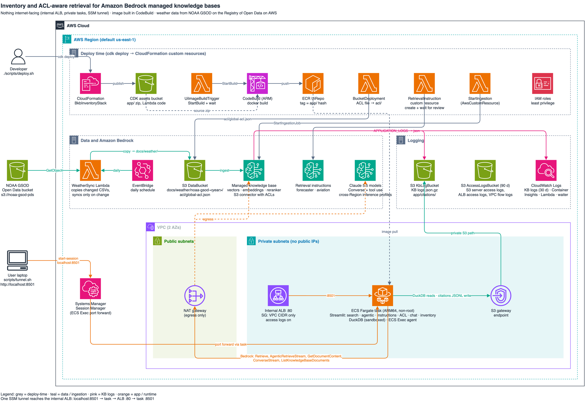
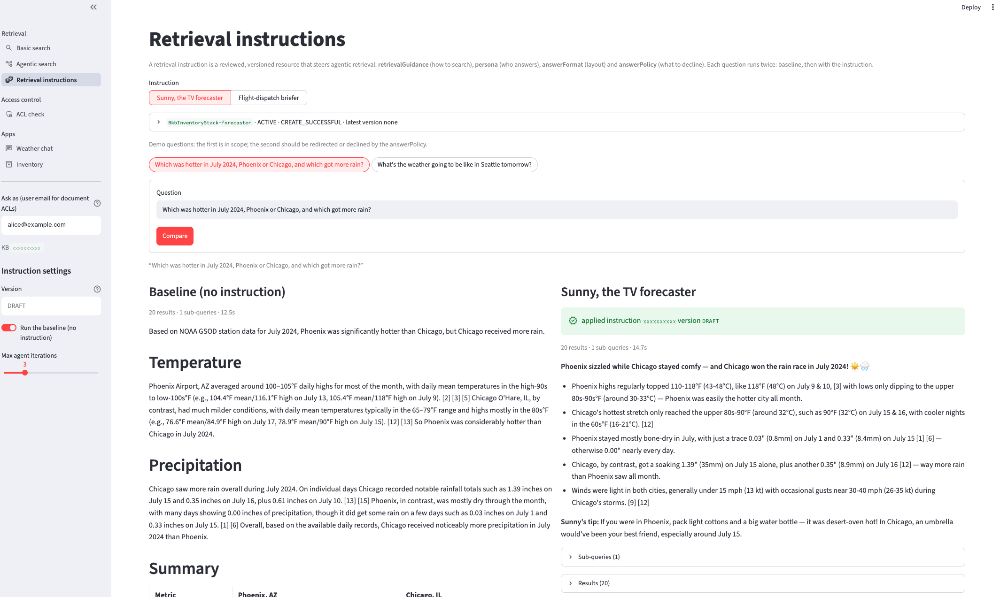
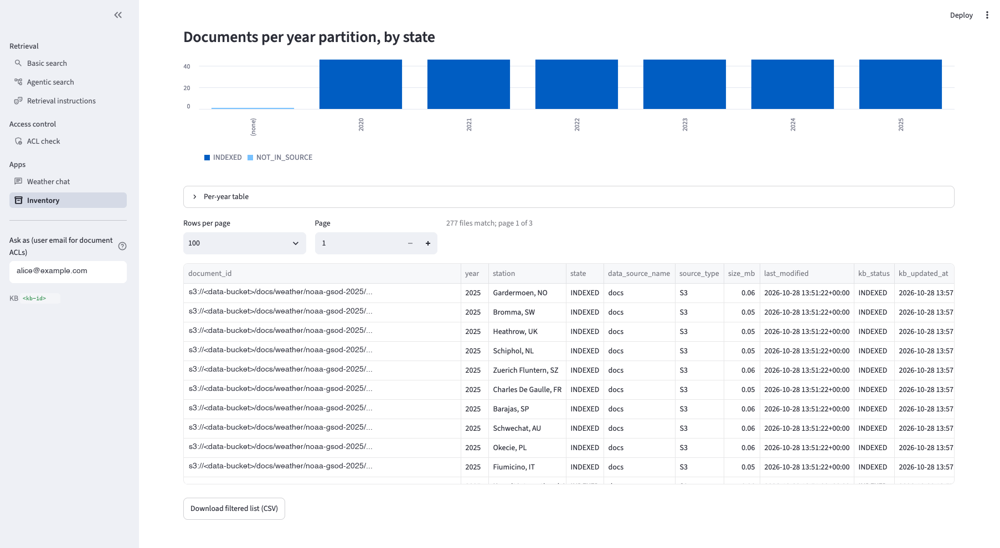

# Inventory and ACL-aware retrieval for Amazon Bedrock managed knowledge bases

This sample deploys an Amazon Bedrock managed knowledge base over public NOAA weather data, protected by document-level access control lists (ACLs), and a Streamlit app to explore it. The app covers:

- basic and agentic search, with retrieval instructions (personas)
- a per-user ACL check
- a Claude chat agent that cites its sources
- an inventory of what the knowledge base has actually ingested, and why other documents were skipped

The data is [NOAA Global Surface Summary of the Day (GSOD)](https://registry.opendata.aws/noaa-gsod/) for 46 airport weather stations, from 2020 onward. It is copied from the AWS Open Data bucket during deployment.

> This is sample code, for non-production usage. You should work with your security and legal teams to meet your organizational security, regulatory and compliance requirements before deployment.



The editable diagram source is [`architecture/bkb-inventory.drawio`](architecture/bkb-inventory.drawio) (AWS icons, `mxgraph.aws4`).

## What gets deployed

| Piece | Choice | Why |
|---|---|---|
| Knowledge base | **Managed** knowledge base (`type: MANAGED`): Bedrock owns the vector store, embeddings and reranker | Required for document-level ACLs on Amazon S3 sources. Set the `embeddingModelId` prop to use a custom (1024-dimension) embedding model instead |
| Data source | `MANAGED_KNOWLEDGE_BASE_CONNECTOR`, S3 connector over `docs/`, `aclEnabled: true` | ACL-aware retrieval, see [Document ACLs](#document-acls) |
| Source documents | `docs/weather/noaa-gsod-<year>/*.csv`: 46 airport stations, one partition per year from 2020 to the latest year available (about 3.9 MB per full year). Station list in [`lib/weather-stations.ts`](lib/weather-stations.ts) | Copied S3-to-S3 from `s3://noaa-gsod-pds/<year>/` by the `WeatherSync` AWS Lambda function, so the CSV files never pass through the repository or your machine. It runs at deploy time (custom resource) and daily (`weatherSyncSchedule`). It copies only changed files, removes stations or years that are no longer in range, and starts an ingestion job only when something changed. Change the first year with `-c weatherFromYear=2018` or the `weatherFromYear` prop |
| Sync | `AwsCustomResource` → `StartIngestionJob` | Runs after the documents are copied, the ACL file is uploaded and log delivery exists, so the first sync is logged. A change to the documents or the ACLs triggers a new sync on the next deploy |
| Retrieval instructions | `<stack>-forecaster` and `<stack>-aviation`, defined in [`lib/retrieval-instructions.ts`](lib/retrieval-instructions.ts) and managed by a custom resource (`Custom::BedrockRetrievalInstruction`) that waits for the content review | There is no AWS CloudFormation resource type for them yet. A rejected review fails the deployment with the reasons. The app only reads and applies them |
| Knowledge base logs | Vended `APPLICATION_LOGS` to **S3 (JSON)** and **Amazon CloudWatch Logs** | S3 for analysis with DuckDB, CloudWatch Logs for Logs Insights and alarms |
| App | Streamlit (six pages, see [The app](#the-app)) and DuckDB on AWS Fargate (ARM64) in private subnets, behind an **internal** Application Load Balancer | Nothing is internet-facing |
| Image build | AWS CodeBuild (ARM) → Amazon ECR, started by a custom resource during deployment | No local Docker or container runtime needed |
| Access | Amazon ECS Exec and AWS Systems Manager Session Manager port forwarding through the task to the internal load balancer | No bastion host, no inbound ports from the internet, no public IP addresses |
| Audit logging | S3 server access logs for both buckets, load balancer access logs and VPC Flow Logs in a dedicated bucket (90-day expiry); CloudWatch Container Insights on the cluster | See [Security](#security) |

**Cost**: the always-on parts are the NAT gateway, the load balancer and the Fargate task, roughly USD 70 per month in us-east-1, plus Container Insights, log storage, knowledge base ingestion and model usage. Check current [AWS Pricing](https://aws.amazon.com/pricing/) for your Region, and [tear the stack down](#clean-up) when you are done.

## Prerequisites

- An AWS account and credentials with permissions to deploy the stack, in a Region where Bedrock managed knowledge bases, agentic retrieval, retrieval instructions and the Anthropic Claude models are available. The scripts default to us-east-1.
- Access to the chat models in Amazon Bedrock (by default the `us.anthropic.claude-sonnet-5-5`, `us.anthropic.claude-haiku-5-5` and `us.anthropic.claude-opus-5-5` cross-Region inference profiles).
- Node.js 22 or later, and the AWS CLI v2.
- The [Session Manager plugin for the AWS CLI](https://docs.aws.amazon.com/systems-manager/latest/userguide/session-manager-working-with-install-plugin.html).
- An [AWS CDK bootstrapped](https://docs.aws.amazon.com/cdk/v2/guide/bootstrapping.html) account and Region: `npx cdk bootstrap`.

## Deploy

```bash
npm install
AWS_PROFILE=<your-profile> ACL_ALLOW=alice@example.com,bob@example.com ./scripts/deploy.sh
```

The Region defaults to us-east-1; set `DEPLOY_REGION` to change it. `ACL_ALLOW` and the optional `ACL_DENY` become the global ACL for `docs/`. **Without `ACL_ALLOW`, nothing is ingested.** When you run `cdk deploy` yourself, pass `-c aclAllow=... -c aclDeny=...` or set the `documentAcls` stack prop.

`app/` is uploaded as a zip asset. During the deployment, an ARM CodeBuild project builds the image and pushes it to ECR. A custom resource waits for the build, so a failed build fails the stack. The image tag is the content hash of `app/`, so the image is rebuilt only when the app changes.

The first ingestion takes a few minutes.

The retrieval-instruction custom resource is a Node.js Lambda function bundled locally with esbuild. It bundles `@aws-sdk/client-bedrock-agent` because the SDK built into the Lambda runtime may predate retrieval instructions. To change a persona, edit `lib/retrieval-instructions.ts` and redeploy. The new content is reviewed first, and the previous content keeps serving until the review passes.

## Connect

```bash
AWS_PROFILE=<your-profile> AWS_REGION=us-east-1 ./scripts/tunnel.sh
```

Then open http://localhost:8501.

The script finds the running task and starts a Session Manager port-forwarding session (`AWS-StartPortForwardingSessionToRemoteHost`) that forwards `localhost:8501` to the internal load balancer on port 80. The load balancer only accepts traffic from inside the VPC. A deployment that changes the app replaces the task, so run the script again after such deployments.

## Document ACLs

The S3 data source is ACL-enabled ([documentation](https://docs.aws.amazon.com/bedrock/latest/userguide/kb-managed-ds-s3-acl.html)). The stack writes a global ACL file to `s3://<DataBucket>/acl/global-acl.json`. It has to be in the same bucket as the documents, and it sits outside `docs/` so that it is not ingested itself:

```json
[
  {
    "keyPrefix": "s3://<DataBucket>/docs/",
    "aclEntries": [
      { "Name": "alice@example.com", "Type": "USER", "Access": "ALLOW" },
      { "Name": "bob@example.com",   "Type": "USER", "Access": "DENY" }
    ]
  }
]
```

- `keyPrefix` is an absolute `s3://` URI for a folder (everything under it) or a single object.
- `Name` is the user's email address, matched exactly. `Type` must be `USER`. `Access` is `ALLOW` or `DENY`; a deny overrides an allow.
- **Documents with no ACL entry are not ingested.** They don't show up as failures; they just never appear.
- To override the ACL of one document, put `<file>.metadata.json` next to it, for example `docs/weather/noaa-gsod-2024/72530094846.csv.metadata.json`. It takes precedence over the global file:
  ```json
  { "metadataAttributes": {}, "accessControlList": [ { "Name": "carol@example.com", "Type": "USER", "Access": "ALLOW" } ] }
  ```
- A change to the global file needs a new sync. Redeploying does this automatically.
- `aclEnabled` can't be changed after the data source is created.

Every `Retrieve`, `AgenticRetrieveStream` and `GetDocumentContent` call passes `userContext: { userId: "<email>" }`. Without it, an ACL-enabled data source returns no results. The sidebar has an **Ask as** field, pre-filled with the first allowed email address.

**This is ACL-aware filtering, not authentication.** The app has no sign-in, so anyone who can open the tunnel can type any email address. See [Security](#security).

## The app

A Streamlit multipage app in one container. Every page sends the sidebar's **Ask as** email address as `userContext.userId`.

| Page | API | What it shows |
|---|---|---|
| Basic search (default) | `Retrieve` (hybrid search with managed reranking) | Ranked chunks with station names, plus a control query without a user, which must return nothing |
| Agentic search | `AgenticRetrieveStream` | A live trace (planning, sub-queries, full-document expansions) and a streamed answer whose `[n]` citation marks point into the results table |
| Retrieval instructions | `AgenticRetrieveStream` with `retrievalInstructionConfiguration` | Pick a persona, see its fields and review status, and run a demo question side by side with and without the instruction. The second demo question is one the persona's answer policy should decline or redirect |
| ACL check | `GetDocumentContent` with `userContext` | A documents-by-users matrix of ALLOW / DENY / NOT_FOUND / ERROR, compared with the verdict the stack's ACL predicts, with CSV download. A run where no expected ALLOW returns ALLOW is marked invalid |
| Weather chat | `Converse` with `Retrieve` as a tool | A Claude agent that cites the chunks it used, with each cited document's ingestion history |
| Inventory | S3 and knowledge base APIs, DuckDB over the logs | What the knowledge base has ingested, see below |

Agentic search and the instruction page use `foundationModelType: MANAGED`, so Bedrock picks the planning model. That model is invoked with the caller's credentials, so the task role has `bedrock:InvokeModelWithResponseStream` on `*`, as described in the [Bedrock User Guide](https://docs.aws.amazon.com/bedrock/latest/userguide/kb-test-agentic-retrieve.html#kb-agentic-retrieve-permissions).

The retrieval instructions page runs the same question with and without a persona:



Station names come from the `NAME` column of each CSV file, read with a 2 KB range request and cached for an hour. The ACL check only knows the global ACL file, not per-document `.metadata.json` overrides.

### Weather chat

Claude on Bedrock (the `ConverseStream` API) with one tool, `search_knowledge_base`, backed by the knowledge base `Retrieve` API and filtered by the sidebar user's ACLs. The model decides when and what to search, can search several times per question, and cites retrieved chunks inline as `[S1]`, `[S2]` and so on.

- **Sources**: each answer lists the chunks it cited (station, score, text), joined to the inventory: knowledge base status, chunk count, last ingestion time and how often the document has been cited.
- **Citation events**: the citations of every answer are written as JSON Lines to `s3://<log bucket>/app/citations/dt=YYYY-MM-DD/`. DuckDB reads them back as the `kb_citations` view, so the inventory shows how often each document was used in answers, in addition to whether it was ingested. Each event holds the question and the **Ask as** address, so a lifecycle rule deletes them after 90 days; the knowledge base logs under `AWSLogs/` are kept as the ingestion history.
- **Models**: a sidebar picker over the cross-Region inference profiles in the `chatModelIds` stack prop. The `bedrock:InvokeModel` grant is scoped to those profiles, but agentic retrieval needs `bedrock:InvokeModelWithResponseStream` on `*` (see above), so the task role can stream any model the account has access to. See [Security](#security).
- `RetrieveAndGenerate` isn't used because it requires custom orchestration and generation prompt templates for Claude 5 models. `Retrieve` plus `Converse` with tool use gives more control.

### Inventory

- **Inventory**: search by key, filter by state and group files per day (UTC), by S3 last-modified time or last knowledge base activity. A per-day chart and table, a paginated file list and CSV export of the filtered set. Each row combines three sources, keyed by document ID:
  1. `ListObjectsV2` on the data bucket: what *should* be in the knowledge base
  2. `ListKnowledgeBaseDocuments`: what the knowledge base says it has now (`INDEXED`, `FAILED`, ...)
  3. the knowledge base logs, through DuckDB: the latest status per document, ignore and failure reasons, and how many ingestion jobs touched it

  This surfaces documents that are in S3 but were never ingested, and documents that were ignored and only show up in the logs. It covers **every data source of the knowledge base**, see [Other data sources](#other-data-sources).

  
- **Ingestion jobs**: from `ListIngestionJobs` and the `StartIngestionJob.StatusChanged` log events.
- **Log events**: the raw event timeline.
- **SQL**: read-only DuckDB SQL over the `kb_logs`, `kb_logs_raw` and `kb_citations` views. Only `SELECT` (including `WITH`, `DESCRIBE` and `SUMMARIZE`) and `EXPLAIN` statements run, checked with DuckDB's parser, so `COPY ... TO`, `EXPORT`, `ATTACH`, `CREATE` and `SET` are refused. The connection is also sandboxed: it can only reach the knowledge base log and citation prefixes in the log bucket. Local files, HTTP, other S3 locations, installing extensions and changing settings are blocked.

The app is read-only for the knowledge base: it can't start syncs. Ingestion runs from `cdk deploy` (when the documents or ACLs change) and from the `WeatherSync` schedule (when the source files change).

## Other data sources

The app is connector-agnostic. It discovers the knowledge base's data sources with `ListDataSources` and `GetDataSource` and inventories all of them, so adding a SharePoint, ServiceNow, Confluence, web crawler or other connector to the knowledge base is enough. The stack itself only creates the S3 data source.

- **Logs**: the vended log envelope (`event_timestamp`, `event_type`, `level`, `event`) is the same for every connector. Managed knowledge bases log a connector-independent document event with `document_id`, `source_uri`, `content_type`, per-stage statuses and `connector_document_status` ([documentation](https://docs.aws.amazon.com/bedrock/latest/userguide/kb-managed-observability.html)). Vector knowledge bases nest the location per connector instead (`document_location.s3_location.uri`, `web_location.url`, ...). The `kb_logs` view handles both.
- **Key**: rows are keyed by `document_id` (an `s3://` URI for S3, the connector's ID otherwise). `Retrieve` returns the document's `source_uri` as its location, so chat citations are mapped back to `document_id` through the logs.
- **Source listing**: only S3 data sources can be listed, and the task role can only read `docs/` in its own bucket; grant read access to other buckets to list them too. SaaS sources such as SharePoint and ServiceNow have no listing, so their rows come from `ListKnowledgeBaseDocuments` and the logs only. They show `INDEXED`, `FAILED` or `IGNORED` with reasons and citations, but never `NOT_CONSUMED` or `NOT_IN_SOURCE`.
- **ACLs**: `userContext` works the same for every connector. SharePoint ACLs need `ENTRA_ID_APP_ONLY` authentication, and ServiceNow ACLs enforce its user criteria.

## Design notes

**S3 and CloudWatch Logs for the knowledge base logs.** Both are deployed, for different needs:

- S3 is the copy for analysis. Delivery to S3 costs less than CloudWatch Logs ingestion, and DuckDB reads the files in place. Knowledge base logs can be delivered to S3 as `plain`, `json` or `w3c`, not Parquet. The key layout is `AWSLogs/<account>/bedrock/knowledgebases/<region>/<knowledgeBaseId>/{yyyy}/{MM}/{dd}/{HH}/`, and DuckDB reads only the current knowledge base's prefix, because a replaced knowledge base leaves its old logs behind. Managed knowledge base document events carry `document_id` (the `s3://` URI), `hashed_document_id`, `document_title`, `crawl_action` and the per-stage `crawl_status`, `index_status` and `sync_status`. The `kb_logs` view maps them onto document statuses (for example `sync_status = SUCCESS` → `INDEXED`).
- CloudWatch Logs is the operational copy: Logs Insights for debugging (`filter event.status = "RESOURCE_IGNORED"`) and metric filters or alarms on `level = "ERROR"`. Retention is one month. If cost matters, this is the one to drop.

**DuckDB.** Logs are only written during ingestion jobs (roughly one event per document state change), so even thousands of documents produce little data. DuckDB scans the gzipped JSON files directly, with no AWS Glue or Amazon Athena setup. The `event` column is read as `JSON` because job-level and document-level events have different shapes. Credentials come from the task role and are passed to DuckDB as a secret on every query, so role credential rotation is handled. For much larger volumes, compact the logs to Parquet on a schedule or use Athena.

**Logs are history, not state.** The authoritative list of what is indexed now is `ListKnowledgeBaseDocuments`. The logs add why (ignore reasons) and when. The inventory uses both.

**Scale.** The inventory loads the full S3 listing and knowledge base document list into memory, which works up to roughly 100,000 files, and DuckDB scans the full log history for the latest status per document. Beyond that, compact the logs to Parquet daily and keep a materialized latest-status table.

## Security

- **No internet exposure.** The load balancer is internal and the tasks run in private subnets without public IP addresses. The only way in is a Session Manager session, so access is limited to IAM principals allowed `ecs:ExecuteCommand` and `ssm:StartSession` on the task. The tunnel is encrypted by Session Manager; the load balancer listener itself is HTTP inside the VPC.
- **No authentication in the app.** Everyone who can open the tunnel has the same access, and the **Ask as** field is not an identity. Before sharing the app with users who should only see their own documents, put authentication in front of it (for example Application Load Balancer authentication with Amazon Cognito or your OIDC identity provider) and derive the `userContext` from the authenticated identity.
- **Least privilege.** The app's task role can list and retrieve from this knowledge base, apply the stack's own retrieval instructions, read `docs/` in the data bucket and the log and citation prefixes in the log bucket, and write only chat citations. It can't start ingestion jobs or read the ACL file.
- **Model invocation.** Because agentic retrieval needs `bedrock:InvokeModelWithResponseStream` on `*`, the task role, and anyone allowed to open the tunnel or use ECS Exec on the task, can stream any Bedrock model the account has access to, not only the `chatModelIds` profiles. Bound the cost with an [AWS Budgets](https://docs.aws.amazon.com/cost-management/latest/userguide/budgets-managing-costs.html) budget on Amazon Bedrock or a CloudWatch alarm on the `AWS/Bedrock` invocation and token metrics, and limit who can start a Session Manager session.
- **Container.** The app runs as an unprivileged user, and ECR scans the image on push.
- **Model output.** Answers are rendered as Markdown (raw HTML is not rendered). With the sample's numeric NOAA data that is safe, but a document from an untrusted source could carry instructions that make the model emit Markdown links or images; an image is fetched by the browser and could send text to an external URL. Before connecting untrusted sources, add [Amazon Bedrock Guardrails](https://docs.aws.amazon.com/bedrock/latest/userguide/guardrails.html) (for example prompt-attack filters) to the chat and agentic calls, and strip or neutralize links and images in model output.
- **Data.** Buckets block public access, enforce TLS and use SSE-S3 encryption. The documents are public NOAA data. Don't load sensitive data into this sample without adding the controls your organization requires.
- **Infrastructure checks.** `cdk synth` runs the [cdk-nag](https://github.com/cdklabs/cdk-nag) AwsSolutions rules and fails on any unacknowledged finding. Each accepted finding is acknowledged with its reason at the end of [`lib/bkb_inventory-stack.ts`](lib/bkb_inventory-stack.ts). Accepted [Checkov](https://www.checkov.io/) findings and their reasons are in [`.checkov.yaml`](.checkov.yaml).

## Local development

```bash
cd app && pip install -r requirements.txt && python -c "import duckdb; duckdb.sql('INSTALL httpfs')"
AWS_REGION=us-east-1 KB_ID=... DATA_SOURCE_ID=... DATA_BUCKET=... LOG_BUCKET=... streamlit run app.py
# LOG_GLOB='./sample-logs/**/*.log.gz' reads local log files instead of S3
```

Run the CDK unit tests with `npm test`.

## Clean up

```bash
AWS_PROFILE=<your-profile> AWS_REGION=us-east-1 npx cdk destroy
```

All buckets are emptied and deleted with the stack, and the knowledge base, retrieval instructions and logs are removed. S3 server access logs are delivered with a delay; if the access-log bucket can't be deleted because new log files arrived, run `cdk destroy` again.

## Security issue notifications

See [CONTRIBUTING](CONTRIBUTING.md#security-issue-notifications) for more information.

## License

This sample is licensed under the MIT-0 License. See the [LICENSE](LICENSE) file.

The NOAA GSOD data is provided by the US National Oceanic and Atmospheric Administration through the [Registry of Open Data on AWS](https://registry.opendata.aws/noaa-gsod/). It is not part of this repository.
